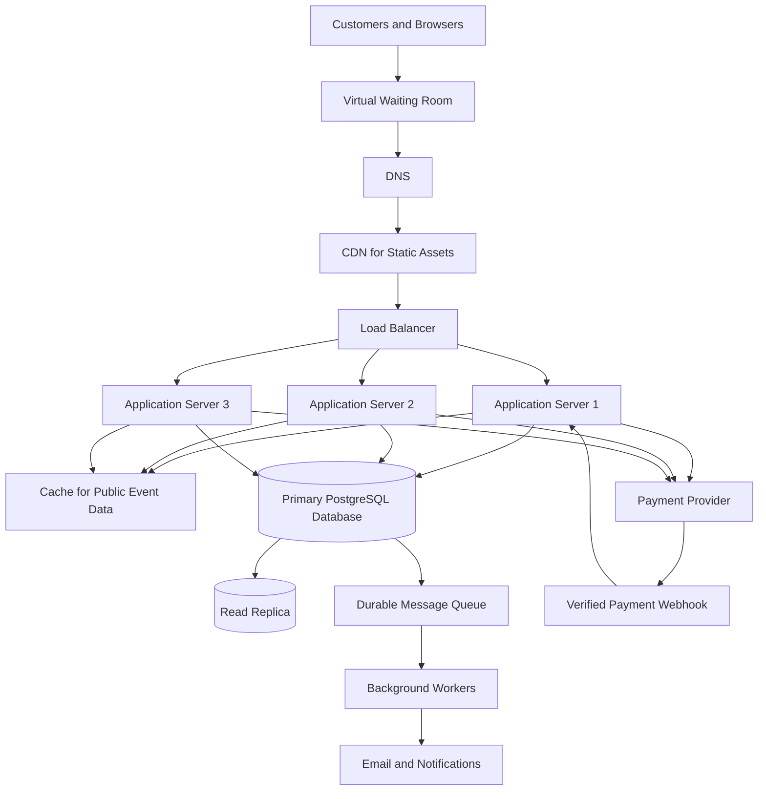

# TicketHub: Event Ticketing System Design

## 1. Requirements

TicketHub is a website that allows customers to discover events, select seats, pay for tickets, and access their purchased tickets.

### 1.1 Functional requirements

The system must allow users to:

1. Register, log in, and manage their accounts.
2. Browse, search, and filter events by name, date, location, and category.
3. View event details, ticket prices, and seat availability.
4. Temporarily hold available seats while completing checkout.
5. Create orders and pay through a trusted payment provider.
6. Receive confirmation and unique tickets after successful payment.
7. View their orders and purchased tickets.
8. Receive clear messages when seats are unavailable or payments fail.
9. Release expired seat holds and process eligible cancellations and refunds.

### 1.2 Non-functional requirements

**Speed:** Event pages should normally load within two seconds. During a major sale, the system should aim to return most API responses within three seconds, excluding delays from external payment providers.

**Correctness:** A seat must never be sold to two customers for the same event. Seat holds, orders, payments, and ticket issuance must remain consistent when requests arrive simultaneously.

**Fairness:** A virtual waiting room will manage access during popular sales. A published queue policy, rate limiting, and anti-bot controls will reduce unfair advantages. Joining the queue does not guarantee a ticket because supply is limited.

**Availability:** Multiple application servers and health checks will help the service remain available. If payment processing or the database cannot safely complete a purchase, the system must not falsely confirm the sale.

**Scalability:** The system must support normal daily traffic and scale during sudden demand increases.

**Security:** Authentication and authorization must protect customer accounts and orders. Passwords must be securely hashed. Payment card details must be handled by a trusted payment provider rather than stored directly by TicketHub.

**Maintainability:** The system will use documented APIs, database constraints, automated tests, monitoring, and logs to support troubleshooting.

---

## 2. Traffic Estimates

TicketHub has 2 million registered users. The calculations below use the supplied figures and explicitly stated assumptions.

### 2.1 Normal traffic

Given:
- 50,000 visitors per day.
- 10 page views per visitor.
- 5,000 tickets sold per day.

**Daily page views**

50,000 × 10 = 500,000 page views per day.

**Average page requests per second**

500,000 ÷ 100,000 = approximately 5 requests per second.

Assuming a five-times peak above the daily average:

5 × 5 = 25 page requests per second.

**Average ticket sales per second**

5,000 ÷ 100,000 = approximately 0.05 tickets per second, or about one ticket every 17 seconds on average.

These are daily averages. Actual traffic and sales will vary by time of day.

### 2.2 Popular concert sale

Given:
- 200,000 people attempt to buy tickets within 10 minutes.
- The concert has 20,000 seats.

**Purchase attempts per second**

200,000 ÷ 600 seconds = approximately 333 attempts per second.

**Seat supply rate over the same period**

20,000 ÷ 600 = approximately 33 seats per second.

**Demand-to-supply ratio**

200,000 ÷ 20,000 = 10 potential buyers per seat.

If each person wants one seat, at most 10% of the people can obtain a ticket.

Assume each potential buyer generates five API requests during the sale:

333 × 5 = approximately 1,665 API requests per second.

This is a planning estimate, not a measured load. Retries, automated traffic, and additional browsing requests may increase demand.

### 2.3 Traffic comparison

| Measure | Normal day | Popular concert sale |
|---|---:|---:|
| Visitors or purchase attempts | 50,000 per day | 200,000 in 10 minutes |
| Page views | 500,000 per day | Depends on user behaviour |
| Average page requests | 5 per second | Not directly comparable |
| Estimated API requests | Normal average about 5 per second | About 1,665 per second |
| Tickets | 5,000 sold per day | 20,000 available |
| Main challenge | Reliable daily service | High concurrency and limited inventory |

The estimated big-sale API demand is roughly 250 times the normal average page-request rate. This comparison is approximate because page requests and API requests are different measures.

The system must scale to handle the extra traffic while protecting the database from conflicting seat reservations.

---

## 3. API Design

The proposed REST API uses the base URL `https://api.tickethub.example.com/v1`. This is an illustrative address, not a live service.

| Method | Endpoint | Purpose | Success status |
|---|---|---|---|
| GET | `/events` | Browse and search events | 200 OK |
| GET | `/events/{eventId}` | View event details | 200 OK |
| GET | `/events/{eventId}/seats` | View seats and their availability | 200 OK |
| POST | `/seat-holds` | Temporarily hold available seats | 201 Created |
| POST | `/orders` | Create an order for held seats | 201 Created |
| POST | `/orders/{orderId}/payment` | Initiate payment | 202 Accepted |
| GET | `/orders/{orderId}` | View an order and its status | 200 OK |
| GET | `/tickets` | View the authenticated user's tickets | 200 OK |

### 3.1 Browse events

Request:

`GET /v1/events?category=concert&page=1`

Example response:

```json
{
  "events": [
    {
      "id": 101,
      "name": "Summer Music Concert",
      "venue": "Central Arena",
      "startsAt": "2027-06-15T18:00:00Z",
      "startingPrice": 25000,
      "currency": "MWK"
    }
  ],
  "page": 1
}
```

Pagination and filtering reduce the amount of data returned. Public event details can be cached.

### 3.2 View seat availability

Request:

`GET /v1/events/101/seats`

Example response:

```json
{
  "eventId": 101,
  "seats": [
    {
      "id": 501,
      "label": "A1",
      "price": 25000,
      "status": "available"
    },
    {
      "id": 502,
      "label": "A2",
      "price": 25000,
      "status": "held"
    }
  ]
}
```

The displayed status may become outdated immediately. The server must verify availability against the primary database when a hold is requested.

### 3.3 Hold seats

Request:

`POST /v1/seat-holds`

Example request:

```json
{
  "eventId": 101,
  "seatIds": [501],
  "idempotencyKey": "hold-request-001"
}
```

Example response:

```json
{
  "holdId": "hold-9001",
  "status": "held",
  "expiresAt": "2027-06-15T17:05:00Z"
}
```

The server creates a short hold, for example five minutes, only if the seat is available. The hold belongs to the authenticated user. Repeating the same request with the same idempotency key must not create duplicate holds.

### 3.4 Create an order

Request:

`POST /v1/orders`

Example request:

```json
{
  "holdId": "hold-9001",
  "idempotencyKey": "order-request-001"
}
```

Example response:

```json
{
  "orderId": 7001,
  "status": "pending_payment",
  "amount": 25000,
  "currency": "MWK"
}
```

The server verifies ownership and expiry of the hold. It calculates the price using trusted database values, not a price supplied by the browser.

### 3.5 Initiate payment

Request:

`POST /v1/orders/7001/payment`

Example request:

```json
{
  "paymentMethodToken": "provider-issued-token",
  "idempotencyKey": "payment-request-001"
}
```

Example response:

```json
{
  "orderId": 7001,
  "paymentStatus": "processing"
}
```

The payment provider processes the transaction and sends a verified webhook to TicketHub. TicketHub confirms payment and issues tickets only after validating the payment result.

### 3.6 View tickets

Request:

`GET /v1/tickets`

Example response:

```json
{
  "tickets": [
    {
      "ticketId": "ticket-3001",
      "eventId": 101,
      "seatLabel": "A1",
      "status": "valid"
    }
  ]
}
```

The server returns only tickets belonging to the authenticated user.

### 3.7 API errors

The API uses consistent HTTP status codes:

- `400 Bad Request`: Invalid input.
- `401 Unauthorized`: Authentication is missing or invalid.
- `403 Forbidden`: The user lacks permission.
- `404 Not Found`: The requested resource does not exist.
- `409 Conflict`: A seat is unavailable or a hold has expired.
- `429 Too Many Requests`: The client exceeded a rate limit.
- `500 Internal Server Error`: Unexpected server failure.
- `503 Service Unavailable`: A required service cannot safely process the request.

Example:

```json
{
  "error": {
    "code": "SEAT_UNAVAILABLE",
    "message": "This seat is no longer available.",
    "requestId": "req-12345"
  }
}
```

---

## 4. Data Model

TicketHub uses PostgreSQL, a relational database. Transactions and constraints are important because many users may try to buy the same seat simultaneously.

The four core tables are `users`, `events`, `seats`, and `orders`. An additional `order_items` table connects orders to the seats they contain.

### 4.1 Relationships

- One user can place many orders.
- One event can have many seats.
- One order belongs to one user.
- One order can contain multiple seats.
- Each seat can appear in no more than one order item.
- A seat can be temporarily held by a user before it is purchased.

### 4.2 Table schemas

The following SQL defines the core tables, primary keys, foreign keys, and important constraints.

```sql
CREATE TABLE users (
    id BIGINT GENERATED ALWAYS AS IDENTITY PRIMARY KEY,
    name VARCHAR(150) NOT NULL,
    email VARCHAR(255) NOT NULL UNIQUE,
    password_hash TEXT NOT NULL,
    created_at TIMESTAMPTZ NOT NULL DEFAULT NOW()
);

CREATE TABLE events (
    id BIGINT GENERATED ALWAYS AS IDENTITY PRIMARY KEY,
    name VARCHAR(200) NOT NULL,
    description TEXT,
    venue VARCHAR(200) NOT NULL,
    starts_at TIMESTAMPTZ NOT NULL,
    status VARCHAR(20) NOT NULL DEFAULT 'draft',
    CHECK (
        status IN ('draft', 'published', 'cancelled', 'completed')
    )
);

CREATE TABLE orders (
    id BIGINT GENERATED ALWAYS AS IDENTITY PRIMARY KEY,
    user_id BIGINT NOT NULL REFERENCES users(id),
    status VARCHAR(30) NOT NULL DEFAULT 'pending_payment',
    total_amount NUMERIC(12, 2) NOT NULL
        CHECK (total_amount >= 0),
    currency CHAR(3) NOT NULL,
    idempotency_key VARCHAR(150) NOT NULL UNIQUE,
    created_at TIMESTAMPTZ NOT NULL DEFAULT NOW(),
    CHECK (
        status IN (
            'pending_payment',
            'paid',
            'cancelled',
            'refunded'
        )
    )
);

CREATE TABLE seats (
    id BIGINT GENERATED ALWAYS AS IDENTITY PRIMARY KEY,
    event_id BIGINT NOT NULL REFERENCES events(id),
    seat_label VARCHAR(30) NOT NULL,
    price NUMERIC(12, 2) NOT NULL CHECK (price >= 0),
    status VARCHAR(20) NOT NULL DEFAULT 'available',
    held_by_user_id BIGINT REFERENCES users(id),
    hold_expires_at TIMESTAMPTZ,
    order_id BIGINT REFERENCES orders(id),
    UNIQUE (event_id, seat_label),
    CHECK (status IN ('available', 'held', 'sold'))
);

CREATE TABLE order_items (
    id BIGINT GENERATED ALWAYS AS IDENTITY PRIMARY KEY,
    order_id BIGINT NOT NULL REFERENCES orders(id),
    seat_id BIGINT NOT NULL UNIQUE REFERENCES seats(id),
    price_at_purchase NUMERIC(12, 2) NOT NULL
        CHECK (price_at_purchase >= 0)
);

CREATE INDEX idx_events_status_start
    ON events(status, starts_at);

CREATE INDEX idx_seats_event_status
    ON seats(event_id, status);

CREATE INDEX idx_orders_user_created
    ON orders(user_id, created_at DESC);
```

### 4.3 Why the constraints matter

- `users.email UNIQUE` prevents multiple accounts from using the same email address.
- `seats UNIQUE(event_id, seat_label)` prevents duplicate seat labels for the same event.
- `order_items.seat_id UNIQUE` prevents the same seat from being assigned to multiple order items.
- Foreign keys prevent orders, seats, and order items from referencing nonexistent records.
- `CHECK` constraints reject invalid seat and order statuses or negative prices.
- The unique order idempotency key prevents the same logical order request from creating duplicate orders.

The database constraints complement application logic; they do not replace it. The application must ensure that seat status, order status, and order-item records agree.

### 4.4 Example queries

Find available seats for an event:

```sql
SELECT id, seat_label, price
FROM seats
WHERE event_id = 101
  AND status = 'available'
ORDER BY seat_label;
```

Find a user's orders:

```sql
SELECT id, status, total_amount, currency, created_at
FROM orders
WHERE user_id = 42
ORDER BY created_at DESC;
```

Find seats purchased in an order:

```sql
SELECT o.id AS order_id,
       s.seat_label,
       oi.price_at_purchase
FROM orders o
JOIN order_items oi ON oi.order_id = o.id
JOIN seats s ON s.id = oi.seat_id
WHERE o.id = 7001;
```

Indexes support common lookups, while unique constraints and transactions protect the integrity of the data.

---

## 5. Architecture and Concurrency Handling

### 5.1 Architecture diagram



### 5.2 Components

**Customers and browsers:** Allow users to search for events, select seats, and purchase tickets.

**Virtual waiting room:** Controls how many customers enter the checkout system at once. It applies a documented queue policy and helps protect the database from sudden overload.

**DNS:** Directs customers to the correct service address.

**CDN:** Delivers static files such as images, CSS, and JavaScript close to users, reducing application server traffic.

**Load balancer:** Distributes API requests across healthy application servers and removes unhealthy instances from service.

**Application servers:** Authenticate users, validate requests, apply booking rules, and communicate with the database and payment provider. Multiple servers allow horizontal scaling.

**Cache:** Stores public event information to reduce repeated database reads. The cache is not the authority for deciding whether a seat can be purchased.

**Primary database:** Stores authoritative seat, hold, and order information. Transactions, row locks, and constraints protect correctness.

**Read replica:** Handles suitable read-heavy queries. Because replication may lag, the primary database is used for final booking decisions.

**Message queue and workers:** Process notifications and other non-critical work asynchronously, allowing checkout to remain responsive.

**Payment provider:** Processes payments without requiring TicketHub to store raw card details.

**Verified webhook:** Reports payment outcomes. TicketHub verifies webhook authenticity and handles repeated notifications idempotently.

### 5.3 How TicketHub prevents two customers buying the same seat

The browser may show a seat as available even though another customer is attempting to reserve it. Therefore, the browser and cache cannot make the final booking decision. The primary database must enforce seat ownership.

TicketHub uses four protections: database transactions, row-level locking, unique constraints, and safe hold-expiration rules.

#### Step 1: Start a transaction and lock the seat

When a customer requests a seat hold, the application starts a database transaction and locks the requested seat row.

Illustrative SQL:

```sql
BEGIN;

SELECT id, status, held_by_user_id, hold_expires_at
FROM seats
WHERE id = 501
FOR UPDATE;
```

`FOR UPDATE` locks the selected row until the transaction ends. If another transaction tries to lock the same row, it must wait.

#### Step 2: Check the current state

While holding the lock, the application checks whether the seat is available or whether its previous hold has expired.

If the seat is already sold or has an active hold owned by another customer, the application rejects the request and rolls back the transaction.

#### Step 3: Assign the hold atomically

If the seat is available, the application assigns the hold and expiry time.

```sql
UPDATE seats
SET status = 'held',
    held_by_user_id = 42,
    hold_expires_at = NOW() + INTERVAL '5 minutes'
WHERE id = 501;

COMMIT;
```

The update must occur only after the application has verified the locked row's state. The code above illustrates the update, not a complete standalone booking procedure.

Because the row remains locked during the check and update, two transactions cannot both successfully claim the same available seat. The second request waits, then sees the committed state and is rejected if the seat is held or sold.

#### Step 4: Create the order

The customer can create an order only for a valid hold belonging to them. The server calculates the price from the database and records the order and its idempotency key.

A repeated request with the same idempotency key returns the existing logical result instead of creating another order.

#### Step 5: Confirm payment and sell the seat

Payment processing takes place through an external provider, so it should not hold a database transaction open while waiting for a network response.

After TicketHub verifies successful payment, it starts a short database transaction that:

1. Locks the relevant order and seat rows.
2. Checks that the order, hold, and payment state are valid.
3. Confirms that the seat has not been sold to someone else.
4. Inserts the order item.
5. Changes the seat status to `sold` and links it to the order.
6. Marks the order as `paid`.
7. Commits all related database changes together.

If any required operation fails, the database transaction rolls back. The unique constraint on `order_items.seat_id` provides a final defence against assigning the same seat to two order items.

Ticket issuance occurs only after the payment and seat-sale state has been successfully confirmed.

#### Step 6: Handle expiry and payment failures

A background process identifies expired holds and releases them only if they still belong to the expired hold attempt and the seat has not been sold.

If a payment succeeds after its hold has expired and another customer has purchased the seat, TicketHub must not issue a duplicate ticket. It must reconcile the payment and arrange a refund or another defined recovery action.

Repeated payment requests and webhooks must be processed idempotently so that retries do not create duplicate charges or tickets.

**Result:** Row-level locking serializes competing claims to the same seat, database transactions keep related changes consistent, and the unique seat constraint prevents duplicate order-item assignments.

### 5.4 How the architecture survives a major sale

1. **Waiting room:** Controls how many customers enter checkout concurrently.
2. **Horizontal scaling:** Additional application servers can be added as request volume increases.
3. **CDN and caching:** Reduce requests reaching the application tier for static assets and public event details.
4. **Database protection:** Indexes, connection pooling, short transactions, and row-level locks reduce unnecessary work and protect seat inventory.
5. **Rate limiting:** Limits abusive clients and excessive repeated requests.
6. **Idempotency:** Makes retries safe for holds, orders, and payments.
7. **Asynchronous processing:** Email and notifications are handled by workers rather than slowing the purchase path.
8. **Monitoring:** Tracks response times, queue length, database locks, errors, payment failures, and server health.
9. **Recovery:** Durable queues, safe retries, payment reconciliation, and database backups support recovery from failures.

The waiting room controls access but does not reserve seats itself. The primary database remains the source of truth for actual seat ownership.

---

## 6. Trade-Offs

### Trade-off 1: Correctness versus response speed

Strong consistency requires database coordination and locking. During a popular sale, many customers may compete for the same seats, increasing waiting times.

TicketHub prioritizes correct seat ownership over accepting every request immediately. It reduces contention through short transactions, indexes, and a waiting room, while caching public event data. Cached seat availability is never treated as proof that a seat can be sold.

### Trade-off 2: Queue fairness versus immediate access

A waiting room protects the service but forces customers to wait. Queue policies can also create concerns about fairness.

TicketHub publishes its queue rules, limits automated abuse, and provides queue status information. For a very high-demand event, it could use a randomized queue for customers who arrive before a stated cutoff. For other sales, first-in-first-out processing may be more suitable. Neither policy guarantees a ticket when demand exceeds supply.

### Trade-off 3: Read replicas versus fresh data

Read replicas increase read capacity, but they may not immediately reflect the latest changes.

TicketHub uses replicas for suitable read-heavy requests while sending seat holds, final purchase decisions, and order confirmation to the primary database. This adds complexity but protects correctness.

### Trade-off 4: Short holds versus customer convenience

Short holds return abandoned seats to the available inventory quickly, but customers may need more time to complete payment. Longer holds improve convenience but can block other customers from buying seats.

TicketHub uses a clearly displayed, short hold period and safely releases expired holds. Payment idempotency and reconciliation help manage delayed or repeated payment responses.

---

## Conclusion

TicketHub must support normal traffic while remaining correct during sudden demand spikes. A waiting room, CDN, cache, load balancer, and multiple application servers help manage traffic. A relational database, transactions, row-level locks, and unique constraints protect seat inventory.
